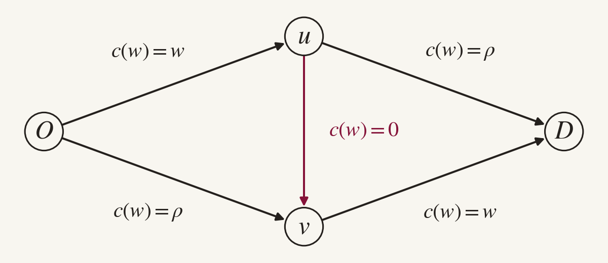

# FOE Demo

This demo lets you explore how navigation platforms (mediators) interact on the Braess network. For the full study by Zhengyang Wang and Achilleas Anastasopoulos, see **[Fragmented Obedient Equilibria in Routing Games](https://arxiv.org/abs/2610.39225)**.

## Model preliminaries

The circles are junctions (nodes) and the arrows are one-way roads (edges). One unit of traffic travels from origin $O$ to destination $D$ along three routes.



- **Route flow.** The vector $f=(f_T,f_M,f_B)$ records the traffic on the top, middle, and bottom routes. For example, $f=(0.5,0,0.5)$ puts half the traffic on the top route and half on the bottom route.
- **Edge cost.** The load $F_e=\sum_{r\ni e}f_r$ adds the flow $f_r$ on every route $r$ that uses edge $e$. The cost function $c_e(w)$ gives the travel cost per user at load $w$. A route's cost is the sum of its edge costs.
- **Mediator and policy.** A mediator is a navigation platform serving a fixed group of travelers. For mediator $k$, a policy $\tau_k$ is a probability distribution over route-flow vectors $f^{(k)}$ whose entries sum to the group's size. Each mediator independently draws a vector and gives private route recommendations according to that split. If users follow their recommendations, the group flows add to $f=\sum_k f^{(k)}$.
- **Why the demo shows mean load.** In a toy example with two equal groups, one mediator always recommends the bottom route. The other chooses $(0.5,0,0)$ or $(0,0.25,0.25)$ with equal probability. The total flow is then $(0.5,0,0.5)$ or $(0,0.25,0.75)$. The edge $O\to u$ carries the top and middle routes, so its load is $0.5$ or $0.25$. The demo summarizes the possible loads at a replay step using their probability-weighted mean $w=\mathbb{E}[F_e]$. For this edge in the example, $w=(0.5+0.25)/2=0.375$.
- **Obedience and equilibrium.** A policy is $\epsilon$-obedient if, given a recommendation, no other route offers more than $\epsilon$ in expected cost savings. At a fragmented obedient equilibrium (FOE), each mediator minimizes its group's expected total travel cost over obedient policies given the other mediators' policies.

## Tune the demo

| Control | Saved values | Meaning |
| --- | --- | --- |
| Constant edge cost $\rho$ | 0 to 2 in steps of 0.05 | Cost per traveler on $O\to v$ and $u\to D$. |
| Obedience tolerance $\epsilon$ | 0 to 1.5 in steps of 0.025 | Larger values relax the obedience constraint. |
| Mediator populations | 1–12 equal groups or a 70/10/10/10 split | How the demand is divided among mediators. |

Each combination selects a saved scenario. The timeline replays Jacobi updates, where all mediators respond to the previous step’s rival mean flows. Compare with the **social optimum**, which minimizes total travel cost, and **Wardrop equilibrium**, where every used route has minimum cost at the resulting flows.

## Run locally

From this folder, start the static server.

```sh
python3 -m http.server 8766 --bind 127.0.0.1
```

[Open the demo](http://127.0.0.1:8766/) · [MIT License](LICENSE)
